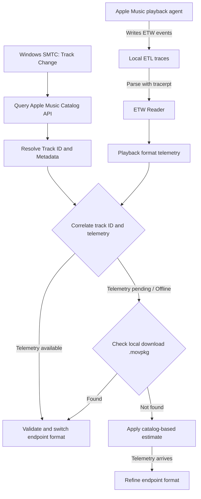

<div align="center">
  
  <h1>RateAlign</h1>
  <p><b>Apple Music Audio Format Synchronizer for Windows</b></p>
  <p>Automatically adjusts the Windows audio output format based on the format reported by Apple Music playback metadata and local telemetry.</p>

  [](https://microsoft.com/windows)
  [](https://www.rust-lang.org/)
  [](LICENSE)
</div>

<div align="center">
  
</div>

---

## Quick start

Get a build from [Releases](https://github.com/pratama1246/AMWin-LosslessSwitcher/releases), run it, select the output in Settings, and play a track in Apple Music. Version 0.3.5 refers to the current source/build; it does not imply that a public release has already been published.

[Code architecture](docs/ARCHITECTURE.md) · [Privacy](PRIVACY.md) · [Usage information](TERMS.md) · [Release notes](RELEASE_NOTES_v0.3.5.md)

## Overview

RateAlign was previously named RateMatch (v0.3.4) and LosslessSwitcher For Apple Music. It currently supports Apple Music for Windows.

Apple Music for Windows does not automatically change the Windows audio endpoint format to match each track's sample rate. The endpoint can therefore remain set to one static format while the Windows Audio Engine handles playback streams with different sample rates.

**RateAlign** is a lightweight Windows utility that monitors Apple Music playback and synchronizes the selected Windows audio endpoint format with the active track. It combines Windows System Media Transport Controls (SMTC), Apple Music Catalog metadata, and local Event Tracing for Windows (ETW) telemetry from Apple's playback agent (`AMPLibraryAgent.exe`).

The application changes the Windows endpoint format only. It does not intercept, capture, re-encode, or otherwise modify the audio stream.

<div align="center">
  
  
</div>

## Settings and About

Settings separates device selection, switching modes, behavior and advanced actions. Test notification sends a preview without changing the output format. About contains the package version, project link, License and Privacy; packaged local documents open in Notepad, with a repository fallback when unavailable.

## Mini mode

Select Mini mode for a 480 × 88 always-on-top bar showing artwork, title, artist, album, output format, and status. Drag its background to move it. Use ↗ or Escape to return to the main window and restore its previous always-on-top preference. Mini mode and position are not persisted across restarts.

| Status | Meaning |
| --- | --- |
| Idle | No current track |
| Waiting for playback | Metadata is available; playback/sync is pending |
| Switching… | Synchronization or a retry is in progress |
| Format matched | Synchronized lossless source and output formats agree |
| Rate synchronized | Output may intentionally differ in bit depth |
| Limited by device | A supported fallback was applied |
| AAC playback | The source is reported as lossy |
| Output unavailable | Device initialization, availability, or support failed |

Hover over the mini format for source/output details. These are metadata and endpoint values, not independent PCM measurements.

## Features

- **Hybrid Format Detection** — Combines Apple Music catalog metadata with local ETW playback telemetry to resolve the track's reported format (44.1, 48, 88.2, 96, 176.4, 192 kHz; 16-bit / 24-bit).
- **Offline & Downloaded Media Support** — Resolves native master formats directly from local Apple Music package manifests (`.movpkg`) when offline or when catalog metadata is ambiguous.
- **Automatic Endpoint Switching** — Updates the selected Windows audio endpoint when the resolved track format changes to prevent unnecessary OS sample-rate conversion.
- **Seamless Mode** — Keeps the endpoint at 24-bit while following the track's sample rate (recommended for modern DACs to avoid audio pops).
- **Purist Mode** — Follows both the sample rate and bit depth reported for the track.
- **Format Validation & Auto-Fallback** — Verifies supported formats through WASAPI and selects the highest supported candidate when the requested format exceeds hardware limits.
- **Settling Delay** — Configurable delay (50–800 ms) to give the audio device time to transition between formats.
- **System Tray Support** — Keeps the application running in the system tray with playback information.
- **No Administrator Requirement** — Runs under a standard Windows user account without background consoles or custom audio drivers.
- **Portable Mode** — Option to run as a self-contained executable storing settings and catalog cache beside the binary.

## How It Works

The application uses a hybrid process to identify the format associated with the currently playing Apple Music track:



1. **Track Detection (SMTC):** Monitors Windows System Media Transport Controls to detect the active Apple Music session and track changes. Track information is also used to update the Now Playing view.
2. **Catalog Lookup:** Queries Apple's catalog services to resolve the track ID (`adamID`), audio traits such as `lossless` and `hi-res-lossless`, and artwork information.
3. **Playback Telemetry (ETW):** Reads local diagnostic events written by Apple Music's playback agent (`AMPLibraryAgent.exe`). The reader extracts format fields such as `asbdSampleRate` and `sdBitDepth`, then correlates them with the catalog track ID.
4. **Format Validation and Switching:** Checks the resolved format against formats supported by the selected Windows audio endpoint. The application then applies the selected mode and configured settling delay.

ETW telemetry describes format information reported by Apple's playback components. It is not a measurement of the final PCM signal delivered to the DAC.

> [!IMPORTANT]
> **Sample Rate Synchronization Is Not Bit-Perfect Playback**
>
> RateAlign changes the Windows audio endpoint format to match the format resolved for the active track. This can help avoid sample-rate conversion by the Windows Audio Engine when the endpoint format matches the playback stream, but it does **not** guarantee bit-perfect output and does **not** enable Exclusive Mode.
>
> - Apple Music for Windows uses the **Windows Shared Audio Engine (WASAPI Shared)**.
> - System volume, notification sounds, Windows audio enhancements, driver DSP, and other system-level processing may still affect or mix with audio playback.
> - The application changes the endpoint format; it does not bypass the Windows audio stack.

## Installation

### Option A: Windows installer

Download `RateAlign-Setup-v0.3.5.exe` from [GitHub Releases](../../releases).

The installer:
- Installs the application under `%LOCALAPPDATA%\Programs\AMWin-LosslessSwitcher`.
- Creates Start Menu and Desktop shortcuts.
- Offers an option to launch the application minimized to the system tray when Windows starts.
- Registers an uninstaller in Windows Settings.

### Option B: Portable executable

Download `RateAlign-Portable-v0.3.5.exe` from [GitHub Releases](../../releases) and run it from a folder of your choice.

To store settings and catalog cache files beside the executable, use `--portable` or create an empty `portable.dat` file in the same folder.

## Usage & Settings

### Now Playing

The Now Playing view displays:
- Track title, artist, and album artwork.
- The format resolved for the active track.
- The current format of the selected Windows audio endpoint.
- The current synchronization status.

The application can remain active in the system tray while monitoring playback.

### Audio Settings

- **Output Device** — Select an audio endpoint or follow the Windows default device.
- **Switcher Mode** — Choose Seamless Mode or Purist Mode.
- **Settling Delay** — Configure the delay used during endpoint format changes (50–800 ms).
- **Always on Top** — Keep the application window above other windows.
- **Run on Windows Startup** — Start the application when you sign in to Windows.
- **Clear Cache** — Clear locally stored catalog cache data.

### Optional Apple Music & Windows Settings

These settings are optional. They may help create a more consistent standard stereo playback setup, but they do not enable Exclusive Mode.

- Enable **Lossless Audio** in Apple Music playback settings. Select **Hi-Res Lossless** if you want high-resolution tracks to be available.
- If you prefer standard stereo playback, consider disabling **Dolby Atmos** and **Song Transitions**. **Sound Check** can also be disabled if you do not want loudness normalization.
- Disable Windows audio enhancements, spatial sound, or driver DSP effects if you do not want those effects applied.

Available settings may vary by Apple Music and Windows version.

The screenshots above show an older interface and are retained as historical illustrations.

## Known Limitations

- **Shared Mode Only:** Apple Music for Windows does not provide WASAPI Exclusive Mode or ASIO output. Playback uses the Windows Shared Audio Engine.
- **No Bit-Perfect Guarantee:** Matching the endpoint format does not guarantee a bit-perfect signal. System volume, notification sounds, Windows audio enhancements, and driver-level processing may still affect playback.
- **Device and Driver Compatibility:** Available formats and switching behavior depend on the audio endpoint and its driver. If the requested format is unavailable, the application selects a supported format.
- **Initial Telemetry Delay:** For a track that has not been resolved before, `AMPLibraryAgent.exe` may take around 100–300 ms to write the relevant telemetry to disk. The application initially applies a catalog-based estimate and refines the endpoint format when matching telemetry becomes available.

## Tested Hardware

The following setup has been tested by the project maintainer:

| Operating System | Audio Device / DAC | Tested Format Range | Result |
| :--- | :--- | :--- | :--- |
| Windows 11 (x64) | **FiiO JadeAudio JA11** (USB-C DAC) | `44.1 kHz`–`192 kHz`, `16-bit` / `24-bit` | Tested with Seamless and Purist modes |

This records the maintainer's test setup and does not guarantee compatibility with every device or driver.

## Command Line Arguments

| Parameter | Action |
| :--- | :--- |
| `(none)` | Opens the main application window. |
| `--minimized` or `--tray` | Starts the application minimized to the system tray. |
| `--portable` | Stores settings and catalog cache files beside the executable. |

---

## Code documentation

See [docs/ARCHITECTURE.md](docs/ARCHITECTURE.md) for the source map, thread/state ownership, mini-mode lifecycle, resource cleanup, compatibility identifiers, and validation workflow.

```text
src/
  main.rs          Windows entry point
  ui/              Main window, mini mode, tray and drawing
  coordinator/     Monitoring and switching workflow
  apple_music/     SMTC, catalog and ETW parsing
  audio/           WASAPI endpoints and format application
  config.rs        Preferences and storage selection
assets/            Logo sources, PNG, ICO and icon generator
docs/              Architecture and maintenance guide
installer/         Inno Setup packaging
tests/             Configuration and integration checks
```

## Development

### Requirements

- Windows 10 or Windows 11 (64-bit)
- Rust stable toolchain: `stable-x86_64-pc-windows-msvc`
- Inno Setup 6 (optional, for building the installer)

### Build

```powershell
# Check the project
cargo check

# Run tests
cargo test

# Build the release executable
cargo build --release

# Optional: build the installer
& "$env:LOCALAPPDATA\Programs\Inno Setup 6\ISCC.exe" installer\setup.iss
```

The main application source is under `src/`, with tests under `tests/`. The installer configuration is in `installer/setup.iss`.

## Privacy

RateAlign requests track-related metadata from public Apple services, including Apple Music Web and iTunes. Application settings and catalog cache are stored locally under `%APPDATA%\AMWin-LosslessSwitcher`, or beside the executable in portable mode.

This README does not make a zero-telemetry claim. Such a claim would require an audit of the application source and its dependencies for analytics, telemetry, crash reporting, and other outbound data.

## Acknowledgments & Special Thanks

- [Jordan Gibson — WindowsLosslessSwitcher](https://github.com/jordanmgibson/WindowsLosslessSwitcher), for the Windows project concept and inspiration.
- [Vincent Neo — LosslessSwitcher](https://github.com/vincentneo/LosslessSwitcher), for pioneering automatic Apple Music sample rate switching on macOS.

## License & Legal

This project is licensed under the [GNU General Public License v3.0](LICENSE).

- © 2026 Pratama Putra.
- Not affiliated with Apple Inc. Apple and Apple Music are trademarks of Apple Inc.
