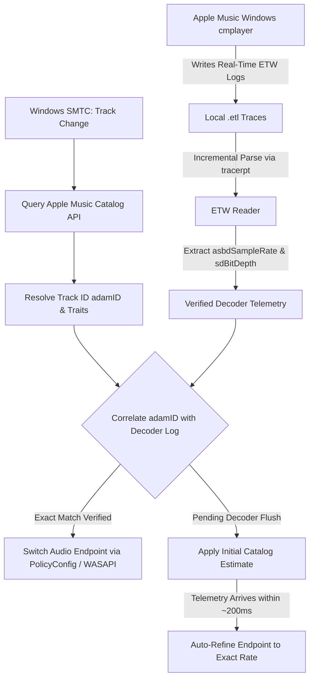

<div align="center">
  
  <h1>LosslessSwitcher For Apple Music</h1>
  <p><b>Apple Music Audio Format Synchronizer for Windows</b></p>
  <p>Automatically adjusts the Windows audio output format to match the track format reported by Apple Music metadata.</p>

  [](https://microsoft.com/windows)
  [](https://www.rust-lang.org/)
  [](LICENSE)
</div>

<div align="center">
  
</div>

---

## Overview

Apple Music for Windows does not automatically adjust the Windows audio endpoint format to match each track's native sample rate. As a result, the output device typically stays locked at a single static sample rate and bit depth in Windows Settings, causing the Windows Audio Engine to resample playback streams.

**AMWin-LosslessSwitcher** is a lightweight, non-intrusive Windows utility that follows Apple Music playback and automatically synchronizes the selected Windows audio endpoint format with the active track. It uses a **hybrid detection engine** combining Windows System Media Transport Controls (SMTC), Apple Music Catalog metadata, and real-time Event Tracing for Windows (ETW) telemetry emitted by Apple Music's native playback agent (`AMPLibraryAgent.exe`).

The application strictly changes the Windows endpoint format; it does not intercept, capture, re-encode, or alter the audio stream.

<div align="center">
  
  
</div>

## Features

- **Hybrid Detection Engine** — Combines Apple Music catalog metadata with real-time local decoder telemetry (ETW) from `AMPLibraryAgent.exe` for exact format resolution (44.1, 48, 88.2, 96, 176.4, 192 kHz; 16-bit / 24-bit).
- **Automatic Endpoint Switching** — Changes the selected Windows audio endpoint when track sample rate changes, avoiding unnecessary OS-level resampling.
- **Seamless Mode** — Keeps the endpoint bit depth at 24-bit while matching track sample rates (recommended for modern DACs).
- **Purist Mode** — Follows both the track sample rate and bit depth strictly.
- **Hardware Validation & Auto-Clamping** — Queries WASAPI drivers to verify supported formats and automatically clamps to the maximum hardware capability if a track exceeds device limits.
- **Smart Settling Delay** — Configurable delay (50–800 ms) with automatic PLL headroom for clock family transitions (44.1k ↔ 48k multiplier transitions).
- **System Tray Support** — Minimizes unobtrusively to the system tray with live track information.
- **Zero Admin Privileges** — Operates entirely under standard user privileges without background consoles or driver hooking.
- **Portable Mode Support** — Option to run as a single self-contained executable with adjacent config storage.

## How It Works

AMWin-LosslessSwitcher uses a multi-stage **hybrid detection engine** to resolve the exact audio parameters of each song playing in Apple Music for Windows:



1. **Session & Track Detection (Windows SMTC):**  
   Monitors Windows System Media Transport Controls to detect track transitions instantly, updating the UI title, artist, and album artwork with zero lag.
2. **Catalog Metadata Correlation (Apple Music Web API):**  
   Resolves the unique Apple Music Track ID (`adamID`), audio traits (`lossless`, `hi-res-lossless`), and artwork URLs via Apple's catalog API.
3. **Native Decoder Telemetry Snooping (Local ETW):**  
   When Apple Music Windows plays a track, its internal CoreMedia player (`cmplayer`) logs diagnostic telemetry to local Windows Event Tracing (`.etl`) files. AMWin-LosslessSwitcher reads these events incrementally and silently (`CREATE_NO_WINDOW`) to extract the exact decoded stream specification (`asbdFormatID = qlac`, `sdFormatID = alac`, exact `asbdSampleRate` such as `96.0 kHz` or `192.0 kHz`, and `sdBitDepth`).
4. **Hardware Verification & Switching (WASAPI / PolicyConfig):**  
   The resolved format is validated against the active DAC's supported candidate formats. If supported, the application synchronizes the Windows audio endpoint format and applies an intelligent settling delay to allow the DAC's PLL clock to stabilize.

> [!IMPORTANT]
> **Sample Rate Synchronization vs. "Bit-Perfect" Audio**  
> AMWin-LosslessSwitcher performs **strict sample rate and bit depth matching** at the Windows audio endpoint level so that the Windows Audio Engine does not apply unnecessary resampling.  
> However, **this is NOT bit-perfect audio and NOT Exclusive Mode**:
> - Apple Music for Windows streams through the **Windows Shared Audio Engine** (WASAPI Shared).
> - System volume sliders, system notification sounds, Windows audio enhancements, driver DSPs, and third-party equalizers can still affect or mix with the digital audio stream.
> - This utility aims to eliminate OS sample rate conversion (SRC) in Shared Mode, but does not bypass the Windows audio stack.

## Installation

### Option A: Windows installer

Download `AMWin-LosslessSwitcher-Setup-v0.3.0.exe` from [GitHub Releases](../../releases).

The installer:
- Installs the application under `%LOCALAPPDATA%\Programs\AMWin-LosslessSwitcher`.
- Creates Start Menu and Desktop shortcuts.
- Offers an option to launch the application minimized to the system tray at Windows startup.
- Registers an uninstaller in Windows Settings.

### Option B: Portable executable

Download `AMWin-LosslessSwitcher-Portable-v0.3.0.exe` from [GitHub Releases](../../releases) and run it from a folder of your choice.

To keep settings and catalog cache files beside the executable, use `--portable` or create an empty `portable.dat` file in the same folder.

## Usage & Settings

### Now Playing

The Now Playing view displays:
- Track title, artist, and album artwork.
- The format resolved from track metadata.
- The current format of the selected Windows audio endpoint.
- The current synchronization status.

The application can be minimized to the system tray while it monitors playback.

### Audio Settings

- **Output Device** — Choose an audio endpoint or follow the Windows default device.
- **Switcher Mode** — Choose Seamless Mode or Purist Mode.
- **Settling Delay** — Set the delay used during endpoint format changes (50–800 ms).
- **Always on Top** — Keep the application window above other windows.
- **Run on Windows Startup** — Start the application when you sign in to Windows.
- **Clear Cache** — Clear locally stored catalog cache data.

### Recommended Apple Music & Windows Settings

These settings may help keep the audio path consistent, but they do not turn Windows Shared Mode into Exclusive Mode.

- Enable **Lossless Audio** in Apple Music playback settings. Choose **Hi-Res Lossless** if you want Apple Music to make high-resolution tracks available.
- Disable **Sound Check**, **Dolby Atmos**, and **Song Transitions** if you prefer standard stereo lossless playback without those features.
- If you use external volume control, you may set Apple Music and Windows volume to 100%. Be aware that this affects system volume and other applications too.
- Disable Windows audio enhancements, spatial sound, or driver DSP effects if you do not want those effects applied.

The exact settings available may vary by Apple Music and Windows version.

## Known Limitations

- **No Exclusive Mode (WASAPI Shared Only):** Apple Music for Windows does not support WASAPI Exclusive Mode or ASIO. Playback routes through the Windows Shared Audio Engine.
- **No Bit-Perfect Guarantee:** Synchronizing the endpoint format prevents sample rate conversion (resampling) in the Windows Audio Engine, but does not guarantee a bit-perfect bitstream. System volume, notification sounds, Windows audio enhancements, and driver-level mixers still operate on the audio stream.
- **Device & Driver Behavior:** Switching speed and accepted formats depend on your DAC's audio driver. Unsupported formats are automatically clamped to the device's hardware maximum.
- **Initial Telemetry Latency:** When playing an uncached track for the very first time, `AMPLibraryAgent.exe` may take 100–300 ms to flush its decoder log to disk. AMWin-LosslessSwitcher handles this by applying an initial catalog estimate and automatically refining the endpoint format once the verified telemetry arrives.

## Tested Hardware

The following combination has been tested by the project maintainer:

| Operating System | Audio Device / DAC | Tested Format Range | Result |
| :--- | :--- | :--- | :--- |
| Windows 11 (x64) | **FiiO JadeAudio JA11** (USB-C DAC) | `44.1 kHz`–`192 kHz`, `16-bit` / `24-bit` | Tested with Seamless and Purist modes |

This is a record of the maintainer's test setup, not a guarantee of compatibility with every device or driver.

## Command Line Arguments

| Parameter | Action |
| :--- | :--- |
| `(none)` | Opens the main application window. |
| `--minimized` or `--tray` | Starts the application minimized to the system tray. |
| `--portable` | Stores settings and catalog cache files beside the executable. |

---

## Development

### Requirements

- Windows 10 or Windows 11 (64-bit)
- Rust stable toolchain: `stable-x86_64-pc-windows-msvc`
- Inno Setup 6 (optional, for building the installer)

### Build

```powershell
# Check the project
cargo check

# Run tests
cargo test

# Build the release executable
cargo build --release

# Optional: build the installer
& "$env:LOCALAPPDATA\Programs\Inno Setup 6\ISCC.exe" installer\setup.iss
```

The main application source is under `src/`, with tests under `tests/`. The installer configuration is in `installer/setup.iss`.

## Privacy

AMWin-LosslessSwitcher requests track-related metadata from public Apple services, including Apple Music Web and iTunes. Application settings and catalog cache are stored locally under `%APPDATA%\AMWin-LosslessSwitcher`, or beside the executable in portable mode.

This README does not make a zero-telemetry claim. That claim should only be added after the application source and its dependencies have been audited for analytics, telemetry, crash reporting, and other outbound data.

## Acknowledgments & Special Thanks

- [Jordan Gibson — WindowsLosslessSwitcher](https://github.com/jordanmgibson/WindowsLosslessSwitcher), for the Windows project concept and inspiration.
- [Vincent Neo — LosslessSwitcher](https://github.com/vincentneo/LosslessSwitcher), for pioneering automatic Apple Music sample rate switching on macOS.

## License & Legal

This project is licensed under the [GNU General Public License v3.0](LICENSE).

- © 2026 Pratama Putra.
- Not affiliated with Apple Inc. Apple and Apple Music are trademarks of Apple Inc.
