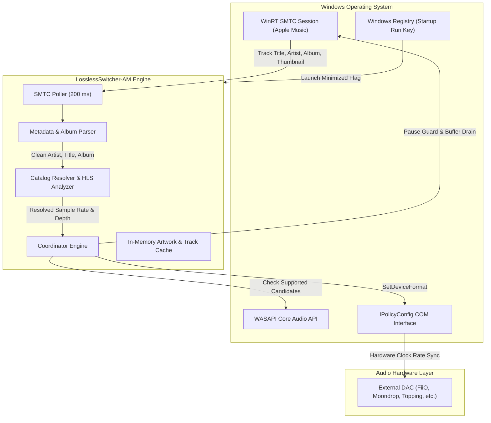

<div align="center">
  
  <h1>LosslessSwitcher-AM</h1>
  <p><b>Automated Audio DAC Sample Rate Synchronizer for Apple Music on Windows 64-bit</b></p>
  <p><i>Synchronizes external DAC clock frequencies and container bit depths with active Apple Music Lossless and Hi-Res Lossless streams.</i></p>

  [](https://microsoft.com/windows)
  [](https://www.rust-lang.org/)
  [](LICENSE)
</div>

---

## 1. Overview

Apple Music for Windows does not natively switch USB Audio Class 2 (UAC2) DAC sample rates when transitioning between Standard Lossless (44.1 kHz / 16-bit, 48 kHz / 24-bit) and Hi-Res Lossless (88.2 kHz, 96 kHz, 176.4 kHz, 192 kHz / 24-bit). The Windows shared audio engine resamples all streams to a single static endpoint format configured in Windows Sound Settings (`mmsys.cpl`), resulting in unnecessary sample rate conversion (SRC) or audio dropouts, track skipping cascades, and DSP synchronization errors on external DACs.

`LosslessSwitcher-AM` is a lightweight, zero-bloat background utility written in Rust. It monitors Apple Music playback via Windows Runtime System Media Transport Controls (WinRT SMTC), resolves exact stream parameters against Apple Music catalog metadata, and dynamically updates the active Windows audio endpoint format via undocumented native `IPolicyConfig` COM interfaces.

- **Zero Web Runtime / No Electron**: Implemented entirely in native Rust using Win32 API and direct OS COM interop.
- **Minimal Resource Footprint**: Operates with strictly under 8 MB of RAM and ~0% idle CPU utilization.
- **RAM Streaming**: Album art and track resolutions stream in system memory using GDI+ without creating temporary image files on disk.
- **Automatic State Restoration**: Captures original DAC format on launch and synchronously restores initial configuration upon exit.
- **Installation Flexibility**: Distributed both as a native Inno Setup 6 installer and as an isolated portable executable.

---

## 2. Installation & Quick Start

### Option A: Windows Setup Installer (Recommended)
Download and execute `LosslessSwitcher-AM-Setup-v0.1.0.exe` from [Releases](../../releases):
- Installs to `%LOCALAPPDATA%\Programs\LosslessSwitcher-AM`.
- Generates Start Menu and Desktop shortcuts.
- Offers optional 1-click launch minimized to the system tray on Windows startup.
- Full uninstaller registered in Windows Settings > Apps.

### Option B: Standalone Portable Executable
Download `lossless-switcher-am.exe` from [Releases](../../releases) and place it in any folder:
- Run directly without installation.
- To store configuration and track caches locally next to the executable instead of `%APPDATA%`, pass `--portable` or create an empty `portable.dat` file in the same directory.

---

## 3. Practical Use Cases

| Deployment Environment | Problem Solved |
| :--- | :--- |
| **USB Dongle DACs (FiiO JA11 / KA11, Moondrop Dawn Pro)** | Prevents USB Audio Class 2 DSP clock desynchronization, eliminating silent pauses, stuttering, and rapid skipping across different sample rates. |
| **Audiophile Desktop Listening Stations** | Delivers bit-perfect DAC clock synchronization matching native Apple Music master resolutions up to 192 kHz. |
| **Shared Audio Desktop Setups** | Adjusts system endpoint rates while maintaining Windows Shared Audio Mode, avoiding exclusive mode locks so system alerts and secondary audio still function. |
| **Mixed-DPI Multi-Monitor Workstations** | Scales cleanly when moved between 100% desktop monitors and 125%–200% high-DPI laptop displays without blurry text or clipped controls. |
| **Unattended Background Operation** | Starts minimized to the notification tray on user login, handling rate switching automatically in the background. |

---

## 4. Core Engineering Capabilities

- **Zero-Crash Playback Guard**: Enforces playback pause verification and a 100 ms WASAPI buffer drain barrier before updating endpoint formats, preventing `0xc0000005 Access Violation` exceptions in Apple Music's `AMP.Services.dll`.
- **Learned Hardware Format Clamping**: Uses `IAudioClient::IsFormatSupported` to passively filter unsupported formats and records hardware ceilings in memory, preventing driver rejection loops on hardware with fixed caps (e.g., Realtek onboard chips limited to 48 kHz).
- **Instantaneous UI State Feedback**: Decouples track transition events from network catalog calls; displays track title, artist, and SMTC thumbnail immediately (0 ms delay) while background PLL clock settling and DAC re-enumeration occur asynchronously.
- **Dual Switching Modes**:
  - **Seamless Mode (Recommended)**: Locks container bit depth to 24-bit while switching sample rates dynamically (44.1 kHz $\leftrightarrow$ 192 kHz). Eliminates container depth re-negotiation and audio popping.
  - **Purist Mode**: Strictly synchronizes both source bit depth (16-bit / 24-bit) and sample rate with zero container padding.
- **Accurate Metadata & Library Matching**:
  - Automatically parses Apple Music for Windows `{Artist} — {Album}` syntax to prevent Library track confusion between single releases and full OST compilations.
  - Normalizes Unicode typography (`’`, `‘`) to ensure exact title equality.
  - Automatically detects Apple Music `"hi-res-lossless"` traits and elevates stream rates beyond public web CDN limits (up to 96 kHz / 192 kHz).
- **Per-Monitor V2 Dynamic DPI Scaling**: Intercepts `WM_DPICHANGED`, scales window geometry to OS suggested bounds, dynamically regenerates GDI vector fonts, and repositions child controls from baseline 96-DPI values without coordinate rounding drift.
- **Hardware Settling Delay Slider (50 ms – 800 ms)**: User-adjustable settling interval accommodating external DAC phase-locked loop (PLL) clock transitions when crossing clock rate families (44.1 kHz family $\leftrightarrow$ 48 kHz / 96 kHz family).
- **Clean Configuration Persistence**: Automatically stores user preferences (`mode`, `settling_delay_ms`, `selected_device_id`, `is_always_on_top`) in `%APPDATA%\LosslessSwitcher-AM\settings.json` (or local folder in portable mode).

---

## 5. System Architecture



---

## 6. Repository Layout

```text
lossless-switcher-x64/
├── assets/
│   ├── app.ico                   # Multi-frame icon (16, 24, 32, 48, 64, 128, 256 px)
│   ├── logo.svg                  # Vector master logo
│   └── logo.png                  # High-resolution raster logo
├── dist/
│   └── LosslessSwitcher-AM-Setup-v0.1.0.exe # Inno Setup 6 installer package
├── installer/
│   └── setup.iss                 # Inno Setup compiler configuration
├── src/
│   ├── apple_music/
│   │   ├── mod.rs                # Module exports
│   │   ├── smtc.rs               # WinRT SMTC session watcher & metadata parser
│   │   └── catalog.rs            # iTunes Search & Apple Music AMP API format resolver
│   ├── audio/
│   │   ├── mod.rs                # AudioFormat definitions & sample rate display
│   │   ├── policy_config.rs      # Native IPolicyConfig COM interface implementation
│   │   └── wasapi.rs             # WASAPI device enumeration & format querying
│   ├── coordinator/
│   │   └── mod.rs                # Synchronization pipeline, pause guards, & rate ceilings
│   ├── ui/
│   │   ├── mod.rs                # UI module entrypoint
│   │   └── window.rs             # Native Win32 GDI window, tray icon, & DPI V2 scaling
│   ├── config.rs                 # Persistent configuration & portable mode logic
│   ├── lib.rs                    # Library root for integration tests
│   └── main.rs                   # Win32 message loop & CLI argument dispatcher
├── tests/
│   ├── test_audio.rs             # WASAPI device enumeration & switcher mode tests
│   ├── test_config.rs            # Settings serialization & deserialization tests
│   ├── test_resolve_songs.rs     # Catalog format resolution & artwork memory tests
│   └── test_storefront.rs        # Windows OS geo storefront detection tests
├── app.manifest                  # Common Controls v6 & Per-Monitor V2 DPI manifest
├── build.rs                      # Resource compilation script
├── Cargo.toml                    # Rust crate manifest & Windows dependencies
├── LICENSE                       # GNU General Public License v3.0
└── lossless-switcher.rc          # Windows resource compiler definition
```

---

## 7. Operational Controls & Configuration

### GUI Controls & Navigation

- **Now Playing Tab**
  - **Artwork Area**: Displays active album artwork decoded in-memory via GDI+ bicubic interpolation.
  - **Track Information**: Active title, artist, source audio format (e.g. `96 kHz / 24-bit`), and active DAC format.
  - **Status Line**: Displays synchronization status (e.g., `Synchronized (96 kHz / 24-bit)`, `Syncing...`, or `Hardware Clamped`).
  - **Minimize to Tray**: Collapses the window to the Windows notification tray.
- **Audio Settings Tab**
  - **Output Device**: Dropdown to select a specific audio endpoint or follow the Windows Default Audio Device.
  - **Switcher Mode**: Select between **Seamless Mode** (frequency switching with 24-bit container) and **Purist Mode** (strict bit-depth matching).
  - **Always on Top**: Keeps the window floating above other applications.
  - **Run on Windows Startup**: Manages the `HKCU\Software\Microsoft\Windows\CurrentVersion\Run` registry entry with `--minimized` parameter.
  - **Settling Delay**: 50 ms to 800 ms trackbar for DAC hardware clock stabilization.
  - **Clear Cache**: Erases local catalog format cache and in-memory artwork buffers.
- **About Tab**
  - Displays build version, runtime architecture, active storefront, and documentation links.

### Recommended Apple Music & Windows Setup (Getting the Cleanest Output)

Apple Music on Windows does not offer a hardware exclusive mode. A clean, uncolored path through the Windows shared-mode mixer at unity gain is what comes closest to true exclusive mode. Unless you are deliberately using system-wide software EQ (such as Equalizer APO), configure the following once:

- **Update to the Latest Version**: Ensure both **Apple Music for Windows** (via Microsoft Store) and **LosslessSwitcher-AM** (via [GitHub Releases](https://github.com/pratama1246/AMWin-LosslessSwitcher/releases)) are updated to the latest version.
- **Enable Hi-Res Lossless**: In Apple Music, go to `Settings` -> `Playback` -> enable **Lossless audio**, and set both *Streaming* and *Download* to **Hi-Res Lossless (ALAC up to 24-bit/192 kHz)**.
- **Disable Sound Check & Dolby Atmos**: In Apple Music `Settings` -> `Playback`, turn off **Sound Check** (volume normalization) and set **Dolby Atmos** to **Off** so stereo lossless streams pass through unaltered.
- **Set Volume to 100% (Unity Gain)**: Set volume to **100%** in three places: Apple Music's in-app volume slider, the Windows system volume, and Apple Music inside the Windows Volume Mixer (`Settings` -> `System` -> `Sound` -> `Volume mixer`), then control listening volume directly on your external DAC or amplifier.
- **Turn Off Audio Enhancements**: Go to `Settings` -> `System` -> `Sound` -> select your DAC under *Output* -> `Properties` -> set **Audio enhancements** to **Off**.
- **Uncheck Legacy Enhancements**: Go to `Settings` -> `System` -> `Sound` -> `More sound settings` (`mmsys.cpl`) -> `Playback` -> select your DAC -> `Properties` -> `Advanced` -> uncheck **"Enable audio enhancements"**.
- **Turn Off Spatial Sound**: On the same device properties page, ensure **Spatial sound** is set to **Off** and disable any DSP effects in your audio driver's own control panel.

### Command Line Arguments

| Parameter | Action |
| :--- | :--- |
| `(none)` | Standard launch; opens the main user interface. |
| `--minimized` or `--tray` | Launches hidden directly into the system tray without taskbar creation (used by Windows Startup). |
| `--portable` | Enforces portable mode; saves `settings.json` and `catalog_cache.json` in the binary's folder. |

---

## 8. Local Development & Build

### Prerequisites

- **Operating System**: Windows 10 or 11 (64-bit)
- **Rust Toolchain**: `stable-x86_64-pc-windows-msvc` (Edition 2024)
- **Inno Setup 6** (optional, for installer creation): Installable via `winget install JRSoftware.InnoSetup`

### Build & Verification Commands

```powershell
# 1. Verify compilation and dependencies
cargo check

# 2. Execute automated test suites
cargo test

# 3. Compile optimized production release binary
cargo build --release

# 4. (Optional) Compile Inno Setup 6 installer
& "$env:LOCALAPPDATA\Programs\Inno Setup 6\ISCC.exe" installer\setup.iss
```

Compiled outputs:
- **Portable Executable**: `target\release\lossless-switcher-am.exe`
- **Installer Package**: `dist\LosslessSwitcher-AM-Setup-v0.1.0.exe`

---

## 9. Security, Privacy & Compliance

- **No DRM Interception**: This software does not decrypt, capture, record, or circumvent Apple FairPlay DRM. All playback is handled natively by the official Apple Music for Windows application.
- **Direct Public Endpoints**: Queries public iTunes Search API and Apple Music Web catalog endpoints directly. No middleman proxy or third-party web scraper is used.
- **Zero Telemetry**: No usage metrics, system information, or personal identifiers are collected or transmitted.
- **Local Persistence Only**: Settings and format caches remain strictly on the local machine under `%APPDATA%\LosslessSwitcher-AM` (or the portable executable directory).

---

## 10. Acknowledgments & Special Thanks

- **[Jordan Gibson (`WindowsLosslessSwitcher`)](https://github.com/jordanmgibson/WindowsLosslessSwitcher)** — Special thanks for the original Windows concept and inspiration that sparked the creation of this native 64-bit re-architecture.
- **[Vincent Neo (`LosslessSwitcher`)](https://github.com/vincentneo/LosslessSwitcher)** — For pioneering automated Apple Music sample rate switching on macOS.

---

## 11. License & Legal

This project is licensed under the [GNU General Public License v3.0 (GPL-3.0)](LICENSE).

- **© 2026 Pratama Putra. All rights reserved.**
- **Not affiliated with Apple Inc.** Apple and Apple Music are trademarks of Apple Inc., registered in the U.S. and other countries and regions.
