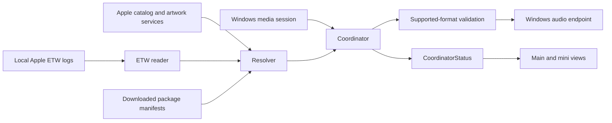

# RateAlign architecture

Applies to v0.3.5. The application uses Rust, Win32 controls, and GDI/GDI+ rendering. It does not host a web UI.

## Code map

| Source | Responsibility |
| --- | --- |
| src/main.rs | Windows entry point; calls ui::run_app |
| src/ui/window.rs | Window/message loop, main and mini layouts, tray, DPI, fonts and artwork |
| src/ui/mini.rs | Pure presentation logic for compact format/status labels |
| src/coordinator/mod.rs | Background monitoring, resolution, switching and shutdown restoration |
| src/apple_music/smtc.rs | Current track, artist, album, duration, artwork and playback state |
| src/apple_music/catalog.rs | Apple lookups, storefront, local manifest fallback and verified cache |
| src/apple_music/etw_reader.rs | Local playback ETL discovery, tracerpt conversion and format correlation |
| src/audio/wasapi.rs | Endpoint enumeration and format validation |
| src/audio/policy_config.rs | Endpoint format application and supported-format fallback |
| src/config.rs | JSON preferences and normal/portable storage selection |
| build.rs / lossless-switcher.rc | Embedded icon and manifest |
| assets/generate_icon.ps1 | Reproducible PNG and multi-size ICO generation |
| installer/setup.iss | Inno Setup packaging |

## Data flow



## Threads and state

The UI owns the Windows message loop. Its 300 ms timer reads CoordinatorStatus; the coordinator performs monitoring and switching in a worker thread. State uses Arc and Mutex. Do not run catalog requests in paint handlers. Do not hold APP_STATE while performing layout or ShowWindow: native calls can synchronously re-enter the window procedure. Drawing/color handlers use try_lock for this reason.

target_format is the resolved source format, not an independent PCM measurement. current_device_format represents the endpoint format. Seamless mode follows sample rate while retaining 24-bit output; a different source depth is therefore not automatically a hardware clamp.

## Mini mode

Mini mode reuses the same window, metadata controls, artwork, coordinator and timer. It removes title-bar chrome, uses a 480 × 88 logical-unit layout, and temporarily enables always-on-top. Background hit testing enables dragging. The expand button or Escape restores the main layout, previous bounds and always-on-top preference. Mini mode and position are not persisted across restarts.

Main-view rectangles are stored in 96-DPI units. apply_dpi rebuilds fonts and artwork; layout_mini then applies compact geometry where required. Mini artwork is rendered at 56 logical units, compared with 112 in the main view. Width-aware ellipsis keeps long metadata inside its allotted area. The mini format tooltip includes source, output and the full coordinator status.

mini::summary is presentation-only. Errors and switching take precedence over completed results. A coordinator status containing (Clamped) becomes Limited by device. Format matched requires a synchronized lossless result with equal source and endpoint formats. Intentional depth differences use Rate synchronized. Physical format support remains the audio layer's responsibility.

## Resource lifetime

WindowState owns font and bitmap handles. Changed artwork replaces and deletes the previous bitmap. DPI changes rebuild and release graphics resources. WM_DESTROY removes the tray icon, shuts down the coordinator, attempts to restore captured device formats, and releases graphics handles. Child windows and tooltip are destroyed with the parent.

## Settings and About

Settings uses a taller layout with separate descriptions for the two switching modes. The main and About pages return to the compact window size. Push buttons share the owner-draw renderer; radio buttons, checkboxes, dropdowns and sliders keep native behavior. Test notification is a UI-only check and does not change endpoint formats. License/Privacy actions prefer packaged local files and fall back to repository links.

## Notification identity

At startup the app sets PratamaPutra.RateAlign as its process AppUserModelID and registers DisplayName/IconUri under the current user’s Software/Classes/AppUserModelId key. The executable includes RateAlign VERSIONINFO metadata. Installer shortcuts use the same AppUserModelID. The existing tray notification mechanism remains Shell_NotifyIconW; verify actual Windows sender attribution rather than inferring it from the message title.

## Compatibility identifiers

RateAlign is the user-facing name and the executable is RateAlign.exe. The Cargo library/package name, mutex, window class, startup registry value, installer AppId and historical storage path remain unchanged to avoid breaking upgrades and preferences. Renaming these requires a migration.

## Development and verification

```powershell
cargo check
cargo test --lib --test test_config --test test_storefront
powershell -NoProfile -File assets/generate_icon.ps1
cargo build --release
```

Regenerate icons before the final build when changing the mark. build.rs tracks app.ico and the manifest; include_bytes tracks logo.png.

The full test suite includes network-dependent catalog/artwork checks and audio integration tests. Inspect tests/test_audio.rs before running: it can attempt to change default endpoint formats. Synthetic status tests do not replace physical device validation.

Manual checks: toggle mini/main repeatedly, drag the bar, restore with expand/Escape, inspect keyboard focus, test long metadata, and check idle, switching, AAC, clamped and unavailable-device states. Test DPI/monitor changes and tray restore before distribution. Record untested hardware states explicitly.
